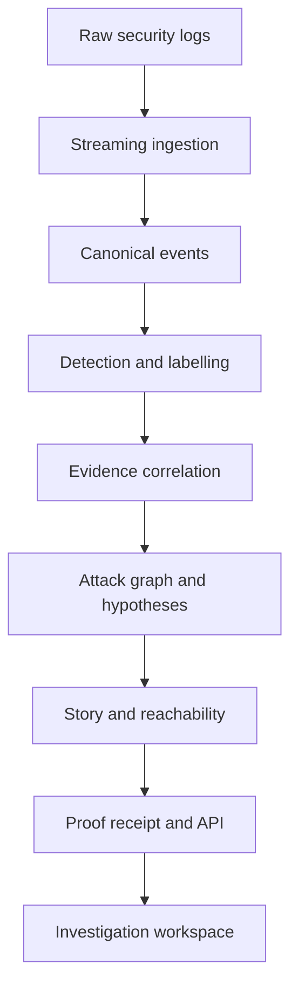

# HALT — Proof-Carrying Kill Chain Intelligence

> From fragmented security logs to a defensible attack story.

HALT reconstructs cyberattacks from disconnected security events. It correlates evidence across users, devices, IP addresses, sessions, tokens, services and time; maps suspicious activity to MITRE ATT&CK and kill-chain stages; and presents the result as an inspectable attack graph, timeline and plain-language story.

HALT is designed to answer four questions:

1. **Where did the attacker enter?**
2. **Which actions and systems are part of the same incident?**
3. **What is observed, what is inferred and how confident are we?**
4. **Which systems could the attacker reach next?**

## CyberForge 2026

HALT is being developed for **CyberForge 2026**, organised by HackCulture and Mitigata, under the official challenge **Kill Chain and Attack Path Analysis**.

The official challenge requires teams to process large security-log datasets without loading them entirely into memory, detect and label suspicious events, connect related activity into attack paths, explain those paths clearly and show what an attacker could reach next.

## Current status

The repository contains two reconstruction paths: a deterministic workflow for bundled synthetic scenarios and small uploads, and a production FireX pipeline for FortiGate-style `key=value` logs that does not load the source into memory.

**The complete 10G and 30G tiers have not yet been run through HALT.** Controlled byte ranges have (see [docs/FIREX_BENCHMARK_REPORT.md](docs/FIREX_BENCHMARK_REPORT.md)). Full-tier commands are in [docs/POWERSHELL_OPERATOR_COMMANDS.md](docs/POWERSHELL_OPERATOR_COMMANDS.md). Official detection accuracy is unknown, because no organiser ground truth has been provided.

| Area | Position |
| --- | --- |
| Synthetic reconstruction | Implemented and tested |
| FireX streaming parser, quarantine and byte accounting | Implemented and tested; measured on whole 10G, 30G and 50G files |
| Disk-backed storage (DuckDB + Parquet), duplicates, bursts | Implemented and tested; measured on whole 10G, 30G and 50G files |
| Config-driven detection and ATT&CK/kill-chain labels | Implemented and tested; accuracy unmeasured |
| Incident graphs, hypotheses and hypothetical reachable-next | Implemented and tested |
| Benchmark and proof receipts (SHA-256 seal) | Implemented and tested |
| Persistent run API with resume and recovery | Implemented and tested |
| Evidence-grounded Groq/xAI explanation | Implemented and tested against a stub; never called against a live provider |
| Simplified UI, semantic 3D Attack World, Trust Centre, Case Builder, Theatre | Implemented and tested |
| SourceTrace search and provenance, analyst reviews | Implemented and tested |
| Live Intake for new FortiGate key-value logs | Implemented and tested |
| Response Handoff from a FireX incident | Implemented; states `NOT EXECUTED`, with no control that acts |
| Adaptive Intake structural profile (optional, read-only) | Implemented and tested; produces proposals only, and no analysis |
| Complete 10G, 30G and 50G runs | Recorded: see the [benchmark report](docs/FIREX_BENCHMARK_REPORT.md) |
| Official-dataset accuracy | Not measured |

## Why HALT is different

Traditional alert dashboards show isolated warnings. HALT focuses on the investigation that comes after an alert:

- It reconstructs a connected incident instead of treating every alert as a separate attack.
- It distinguishes **observed evidence** from **inferred relationships**.
- It retains competing hypotheses when the evidence is ambiguous.
- It cites the events and edges supporting every story statement.
- It records the configuration, versions and hashes needed to reproduce a result.
- It keeps planted ground truth out of the production reconstruction path.
- It does not allow a language model to invent observations or select the attack path.

## End-to-end workflow

```text
Raw security logs
  → streaming ingestion
  → parsing and canonical normalisation
  → exact-duplicate removal and behavioural grouping
  → suspicious-event detection
  → ATT&CK technique and kill-chain labelling
  → entity and temporal correlation
  → evidence-backed attack graph
  → primary and alternate hypotheses
  → timeline, Attack Story and reachable-next analysis
  → proof receipt and deterministic replay
```

## Architecture



For the official large-data path, canonical and suspicious-event records will be stored in a compact disk-backed representation. Only incident-level subgraphs will be materialised in memory.

## Implemented capabilities

- Raw JSON, JSONL and CSV ingestion.
- Seven vendor-like source adapters.
- Canonical security-event schema with evidence hashes.
- Entity resolution across users, devices, sessions, tokens, services and IP addresses.
- Evidence-weighted graph reconstruction.
- Primary and alternate attack hypotheses.
- Observed versus inferred edge classification.
- ATT&CK mapping with mapping-basis disclosure.
- Evidence-linked deterministic Attack Story.
- Reconstruction receipt with input, configuration, context and graph hashes.
- Deterministic replay for bundled scenarios.
- API restart recovery for bundled runs.
- Responsive desktop, tablet and mobile investigation views.
- Explicit API-unavailable and expired-upload states.
- Demo reset guarded by `HALT_DEMO_MODE` and disabled by default.

## Investigation workspace

The PS2 workflow begins at `/reconstruct`. A completed reconstruction opens at `/reconstructions/[reconstructionId]`.

| View | Purpose |
| --- | --- |
| Attack Graph | Visualises events, entities and evidence-backed relationships. |
| Evidence Inspector | Shows the rule, supporting records, confidence components and contradictions for a selected node or edge. |
| Attack Story | Presents the reconstructed incident in chronological, analyst-readable form with citations. |
| ATT&CK | Shows mapped tactics and techniques, their basis and their position in the selected path. |
| Hypotheses | Compares the primary path with credible alternatives and exposes close score margins. |
| Proof | Records inputs, versions, hashes, evidence coverage and deterministic replay information. |
| Evaluation | Compares a bundled reconstruction against isolated synthetic ground truth. It is not available for ordinary uploads. |

## Evidence model

HALT does not present every graph connection as fact.

### Observed

An observed relationship is directly supported by shared identifiers or explicit telemetry, such as a common session, token lineage or source record.

### Inferred

An inferred relationship is supported by a declared correlation rule, such as entity continuity, temporal proximity or attack-stage progression. The interface displays its confidence, supporting events and rule version.

### Uncertain

When two paths have similar scores, HALT retains both as competing explanations and identifies the evidence an analyst should examine. A shortest or highest-scoring path is never presented as an observed attack merely because it is mathematically convenient.

## Duplicate handling and data reduction

HALT separates **exact duplication** from **repeated behaviour**:

- Exact duplicate records can be removed using deterministic canonical/evidence hashes.
- Repeated failed logins, scans or access attempts are not silently discarded; repetition may itself be the attack signal.
- Repeated records can be grouped into bounded behavioural bursts while preserving their counts and original evidence references.
- Any alert-merging result must retain the number of contributing records.

The FireX production path will perform this reduction incrementally and persist compact intermediate results rather than retaining the full dataset in Python memory.

## Demonstration scenarios

### Scenario A — OAuth consent phishing against Finance Operations

The primary demonstration reconstructs a sequence containing email delivery, suspicious authentication, MFA modification, malicious application consent, token use and finance-resource discovery.

### Scenario B — Service-account abuse in a cloud data platform

The secondary scenario demonstrates ambiguity. Multiple plausible paths are retained so an analyst can compare the evidence instead of receiving false certainty.

Both bundled scenarios are synthetic and labelled as such in the application.

## Official FireX pipeline

The official datasets stay outside Git and outside the upload flow. They are registered by id on the server, and no request can supply a path.

1. **Plan:** one sequential read computes the SHA-256, chunk boundaries and line numbers.
2. **Parse:** worker processes parse chunks into Parquet with deterministic evidence ids. Invalid data becomes coalesced quarantine segments, and every byte is accounted for.
3. **Prepare:** DuckDB finds exact duplicates, collapsed timestamps and time-zone conflicts, with a memory limit and spill to disk.
4. **Reconstruct:** configurable rules produce candidates, which join into incidents only through shared accounts, sources or pivots.
5. **Explain:** graphs, hypotheses, reachable-next, Attack Story and sealed receipts are written per incident.

Start it from `/firex` in the app, or from the operator commands. Details: [architecture](docs/FIREX_PRODUCTION_ARCHITECTURE.md), [schema](docs/FIREX_CANONICAL_SCHEMA.md), [rules](docs/FIREX_DETECTION_RULES.md), [reconstruction](docs/FIREX_GRAPH_RECONSTRUCTION.md), [graph contract](docs/INCIDENT_GRAPH_CONTRACT.md), [LLM boundary](docs/LLM_EVIDENCE_BOUNDARY.md), [3D view](docs/3D_INVESTIGATION_SPEC.md), [benchmarks](docs/FIREX_BENCHMARK_REPORT.md), [demo runbook](docs/FINAL_DEMO_RUNBOOK.md).

Every incident is **unconfirmed** until validated.

## Technology

### Frontend

- Next.js 16
- React 19
- TypeScript
- Tailwind CSS 4
- Cytoscape.js
- Three.js / React Three Fiber for spatial presentation work

### Backend and analysis

- Python 3.12
- FastAPI
- Pydantic
- NetworkX-based incident graph analysis
- PostgreSQL for supported persistence and audit workflows

### Engineering

- REST APIs and WebSocket-based replay/progress foundations
- Strict TypeScript
- Ruff and mypy
- Pytest and Playwright
- Contract and recorded-fixture drift checks

## Repository structure

```text
apps/web/                 Next.js product interface
services/api/             FastAPI services and reconstruction engine
demo-inputs/              Small synthetic/manual demonstration inputs
docs/                     Product, architecture, runbook and evaluation documentation
artifacts/ps2-final/      Verified demonstration screenshots and provenance notes
```

Large FireX files are intentionally excluded from this repository.

## Run locally

### Prerequisites

- Node.js 24.x
- npm
- Python 3.12
- The repository's documented Python environment and dependencies

From the repository root:

```powershell
npm install
$env:HALT_DEMO_MODE="true"
npm run dev
```

Open:

```text
http://localhost:3000/reconstruct
```

The web application and API normally use ports `3000` and `8000`. Keep the development process running while using the application.

`HALT_DEMO_MODE` enables local demo-only operations such as the protected reset endpoint. It is disabled by default and is not a secret.

### Environment

No value is a secret, and `.env.example` lists them all. The ones that matter for log analysis:

| Variable | Purpose | Default |
|---|---|---|
| `HALT_FIREX_DATA_ROOT` | Folder holding `raw/`, `incoming/` and `results/` | `.halt/firex-data` |
| `HALT_ADAPTIVE_INTAKE` | Set to `1` to offer the read-only structural profile in Live Intake | Off |
| `HALT_E2E_DATA_ROOT` | Data root for E2E tests, which never use `HALT_FIREX_DATA_ROOT` | A temporary folder |
| `HALT_E2E_SHOTS` | Where the PS2 E2E tests save screenshots | `artifacts/ps2-workspace` |

`npm run start -w @halt/web` serves the production build from `next build`. Only the Docker image builds Next's standalone output, through `HALT_STANDALONE_BUILD=1`.

## Three-minute demo

1. Open `/reconstruct`.
2. Select **OAuth consent phishing against Finance Operations**.
3. Start ingestion and observe the eight processing stages.
4. Inspect a graph node and edge to show supporting evidence.
5. Open **Attack Story** to compare observed and inferred steps.
6. Open **ATT&CK** to show technique mapping and its basis.
7. Open **Hypotheses** to show uncertainty and alternate explanations.
8. Finish in **Proof** with evidence coverage, hashes and replay information.

Do not upload the official multi-gigabyte FireX files through the browser. They require the dedicated streaming pipeline.

## Verification checkpoint

The latest verified PS2 checkpoint is commit `56123a1` on branch `ps2/kill-chain-intelligence`.

| Suite | Latest verified result |
| --- | ---: |
| Backend tests | 204 passed |
| Web unit tests | 115 passed |
| Focused PS2 browser tests | 17 passed |
| Previous complete browser suite | 57 passed |
| Production build | Passed |
| Contract and fixture drift | Passed |

These results verify the current repository workflow. They are not official FireX accuracy or scale measurements.

## Official requirement alignment

| Requirement | Status |
| --- | --- |
| Read the full dataset without loading it into memory | Implemented; measured on controlled ranges, full tiers not yet run |
| Detect suspicious events | Implemented; accuracy on official data unmeasured |
| Map detections to ATT&CK and kill-chain stages | Implemented through configuration |
| Link events across host, user, IP, account and time | Implemented with bounded entity joins |
| Show timeline and graph views | Implemented, in 2D and 3D |
| Show what the attacker could reach next | Implemented, labelled hypothetical, limited to connections in the log |
| Provide a page, API and README | Implemented |

## Evaluation policy

HALT keeps validation separate from reconstruction:

- The application receives raw logs, not planted answers.
- Ground truth remains validator-only.
- Expected paths are not imported into production code.
- Metrics must report both numerator and denominator.
- Targets are not displayed as achieved results.

The official Great targets include over 90% detection, over 85% correct labels, recovery of every planted path, under 10% false-positive incidents, under one hour of processing, under 8 GB peak memory and under 500 ms to open an indexed incident. These are **evaluation targets, not current claims**.

## Current limitations

- Complete 10G and 30G runs have not been performed, so full-tier time, memory and results are unmeasured.
- Official detection accuracy is unknown. Candidate patterns from profiling are not ground truth.
- Rules that need a duration or rate cannot use records inside a collapsed timestamp, so activity there can be missed.
- These logs carry no payloads or endpoint data, so success of an action cannot be proven from them.
- Reachable-next uses recorded connections only, with no asset inventory or permissions data.
- Response simulation is disabled for FireX incidents, because the log has no business topology or control context.
- Peak memory in receipts is an upper bound (highest worker peak × workers + driver peak), not a sampled total.
- The Groq and xAI paths are tested against a stub, not a live provider.
- INC-2417, SafeCut, EchoLab and Action Gate form the Synthetic Response Lab at `/incidents` and `/response-demo`: a separate demonstration, labelled wherever it opens. It is not derived from any FireX run, and no converter connects a FireX incident to it. FireX incidents end in a [Response Handoff](docs/RESPONSE_HANDOFF.md), which executes nothing.
- [SourceTrace](docs/SOURCETRACE.md) and [Live Intake](docs/LIVE_INTAKE.md) describe evidence search and adding new logs. Only FortiGate key-value logs reach this pipeline.
- The official sources differ: FireX 10G gave reconstructed, unconfirmed incidents; FireX 30G had reconstruction withheld; FireX 50G gave a partial reconstruction from a degraded source, whose 11 incidents do not cover the complete file. See the [benchmark report](docs/FIREX_BENCHMARK_REPORT.md).
- Authentication, tenant management, cloud deployment and active blocking are outside the challenge scope.

## Roadmap

1. Validate candidates against organiser ground truth when it is provided.
2. Add a parser for formats that Adaptive Intake can already profile, with a reviewed mapping manifest.
3. Sample total process-tree memory during a run.

## Responsible use

HALT is an investigation and explanation system. It must be used only with logs, systems and data that the operator is authorised to analyse. It does not exploit, disrupt or attack external systems, and active blocking is not part of the official challenge.

## Open-source and AI assistance disclosure

HALT uses established open-source frameworks and libraries, including Next.js, React, FastAPI, Pydantic, Cytoscape.js, NetworkX and the Python/TypeScript testing ecosystem. Third-party components and datasets must retain their original licences and attribution.

AI coding assistants were used during development for planning, implementation support, review and documentation. All generated work remains subject to human review, repository tests and evidence-based validation. AI-generated text is not treated as security evidence, and no language model independently determines the final attack path.

## Team

- **Tanvir Aditya Bayi**
- **Shaik Farhana**

Built for **CyberForge 2026 — HackCulture × Mitigata**.

