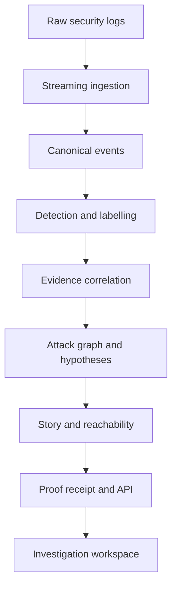

# HALT — Proof-Carrying Kill Chain Intelligence

> From fragmented security logs to a defensible attack story.

HALT reconstructs cyberattacks from disconnected security events. It correlates evidence across users, devices, IP addresses, sessions, tokens, services and time; maps suspicious activity to MITRE ATT&CK and kill-chain stages; and presents the result as an inspectable attack graph, timeline and plain-language story.

HALT is designed to answer four questions:

1. **Where did the attacker enter?**
2. **Which actions and systems are part of the same incident?**
3. **What is observed, what is inferred and how confident are we?**
4. **Which systems could the attacker reach next?**

## CyberForge 2026

HALT is being developed for **CyberForge 2026**, organised by HackCulture and Mitigata, under the official challenge **Kill Chain and Attack Path Analysis**.

The official challenge requires teams to process large security-log datasets without loading them entirely into memory, detect and label suspicious events, connect related activity into attack paths, explain those paths clearly and show what an attacker could reach next.

## Current status

The repository currently contains a complete, deterministic reconstruction workflow for bundled synthetic scenarios and small manual JSON/JSONL/CSV inputs.

The official FireX datasets have since been received and identified as FortiGate-style `key=value` telemetry. A bounded-memory streaming parser and disk-backed processing path for the 10 GB, 30 GB and 50 GB tiers are the next production retrofit. **This README does not claim that the complete FireX tiers have already been processed or evaluated.**

| Area | Current position |
| --- | --- |
| Synthetic reconstruction | Implemented and tested |
| JSON, JSONL and CSV ingestion | Implemented |
| Canonical event model | Implemented |
| Evidence graph and hypotheses | Implemented |
| ATT&CK mapping | Implemented with basis disclosure |
| Explicit kill-chain stage output | Being verified/extended |
| Reachable-next analysis | Planned production addition |
| Official FireX streaming pipeline | In progress |
| Official-dataset accuracy and performance | Not yet measured |

## Why HALT is different

Traditional alert dashboards show isolated warnings. HALT focuses on the investigation that comes after an alert:

- It reconstructs a connected incident instead of treating every alert as a separate attack.
- It distinguishes **observed evidence** from **inferred relationships**.
- It retains competing hypotheses when the evidence is ambiguous.
- It cites the events and edges supporting every story statement.
- It records the configuration, versions and hashes needed to reproduce a result.
- It keeps planted ground truth out of the production reconstruction path.
- It does not allow a language model to invent observations or select the attack path.

## End-to-end workflow

```text
Raw security logs
  → streaming ingestion
  → parsing and canonical normalisation
  → exact-duplicate removal and behavioural grouping
  → suspicious-event detection
  → ATT&CK technique and kill-chain labelling
  → entity and temporal correlation
  → evidence-backed attack graph
  → primary and alternate hypotheses
  → timeline, Attack Story and reachable-next analysis
  → proof receipt and deterministic replay
```

## Architecture



For the official large-data path, canonical and suspicious-event records will be stored in a compact disk-backed representation. Only incident-level subgraphs will be materialised in memory.

## Implemented capabilities

- Raw JSON, JSONL and CSV ingestion.
- Seven vendor-like source adapters.
- Canonical security-event schema with evidence hashes.
- Entity resolution across users, devices, sessions, tokens, services and IP addresses.
- Evidence-weighted graph reconstruction.
- Primary and alternate attack hypotheses.
- Observed versus inferred edge classification.
- ATT&CK mapping with mapping-basis disclosure.
- Evidence-linked deterministic Attack Story.
- Reconstruction receipt with input, configuration, context and graph hashes.
- Deterministic replay for bundled scenarios.
- API restart recovery for bundled runs.
- Responsive desktop, tablet and mobile investigation views.
- Explicit API-unavailable and expired-upload states.
- Demo reset guarded by `HALT_DEMO_MODE` and disabled by default.

## Investigation workspace

The PS2 workflow begins at `/reconstruct`. A completed reconstruction opens at `/reconstructions/[reconstructionId]`.

| View | Purpose |
| --- | --- |
| Attack Graph | Visualises events, entities and evidence-backed relationships. |
| Evidence Inspector | Shows the rule, supporting records, confidence components and contradictions for a selected node or edge. |
| Attack Story | Presents the reconstructed incident in chronological, analyst-readable form with citations. |
| ATT&CK | Shows mapped tactics and techniques, their basis and their position in the selected path. |
| Hypotheses | Compares the primary path with credible alternatives and exposes close score margins. |
| Proof | Records inputs, versions, hashes, evidence coverage and deterministic replay information. |
| Evaluation | Compares a bundled reconstruction against isolated synthetic ground truth. It is not available for ordinary uploads. |

## Evidence model

HALT does not present every graph connection as fact.

### Observed

An observed relationship is directly supported by shared identifiers or explicit telemetry, such as a common session, token lineage or source record.

### Inferred

An inferred relationship is supported by a declared correlation rule, such as entity continuity, temporal proximity or attack-stage progression. The interface displays its confidence, supporting events and rule version.

### Uncertain

When two paths have similar scores, HALT retains both as competing explanations and identifies the evidence an analyst should examine. A shortest or highest-scoring path is never presented as an observed attack merely because it is mathematically convenient.

## Duplicate handling and data reduction

HALT separates **exact duplication** from **repeated behaviour**:

- Exact duplicate records can be removed using deterministic canonical/evidence hashes.
- Repeated failed logins, scans or access attempts are not silently discarded; repetition may itself be the attack signal.
- Repeated records can be grouped into bounded behavioural bursts while preserving their counts and original evidence references.
- Any alert-merging result must retain the number of contributing records.

The FireX production path will perform this reduction incrementally and persist compact intermediate results rather than retaining the full dataset in Python memory.

## Demonstration scenarios

### Scenario A — OAuth consent phishing against Finance Operations

The primary demonstration reconstructs a sequence containing email delivery, suspicious authentication, MFA modification, malicious application consent, token use and finance-resource discovery.

### Scenario B — Service-account abuse in a cloud data platform

The secondary scenario demonstrates ambiguity. Multiple plausible paths are retained so an analyst can compare the evidence instead of receiving false certainty.

Both bundled scenarios are synthetic and labelled as such in the application.

## Official FireX data strategy

The official datasets remain outside Git and outside the web application's upload flow. The production retrofit is designed to:

1. Read the source line-by-line in bounded chunks.
2. Parse FortiGate-style `key=value` records, including quoted values and malformed-line reporting.
3. Normalise timestamps while preserving the original timezone and source value.
4. Generate deterministic evidence IDs from source identity and record position.
5. Persist canonical and suspicious events to a disk-backed store.
6. Index by user, host, IP, account, session, token and time bucket.
7. Correlate within bounded windows.
8. Materialise only incident-level graphs.
9. Measure throughput, peak memory, processing time and incident-open latency.

No official-dataset metric will be published until it has been measured against organiser ground truth.

## Technology

### Frontend

- Next.js 16
- React 19
- TypeScript
- Tailwind CSS 4
- Cytoscape.js
- Three.js / React Three Fiber for spatial presentation work

### Backend and analysis

- Python 3.12
- FastAPI
- Pydantic
- NetworkX-based incident graph analysis
- PostgreSQL for supported persistence and audit workflows

### Engineering

- REST APIs and WebSocket-based replay/progress foundations
- Strict TypeScript
- Ruff and mypy
- Pytest and Playwright
- Contract and recorded-fixture drift checks

## Repository structure

```text
apps/web/                 Next.js product interface
services/api/             FastAPI services and reconstruction engine
demo-inputs/              Small synthetic/manual demonstration inputs
docs/                     Product, architecture, runbook and evaluation documentation
artifacts/ps2-final/      Verified demonstration screenshots and provenance notes
```

Large FireX files are intentionally excluded from this repository.

## Run locally

### Prerequisites

- Node.js 24.x
- npm
- Python 3.12
- The repository's documented Python environment and dependencies

From the repository root:

```powershell
npm install
$env:HALT_DEMO_MODE="true"
npm run dev
```

Open:

```text
http://localhost:3000/reconstruct
```

The web application and API normally use ports `3000` and `8000`. Keep the development process running while using the application.

`HALT_DEMO_MODE` enables local demo-only operations such as the protected reset endpoint. It is disabled by default and is not a secret.

## Three-minute demo

1. Open `/reconstruct`.
2. Select **OAuth consent phishing against Finance Operations**.
3. Start ingestion and observe the eight processing stages.
4. Inspect a graph node and edge to show supporting evidence.
5. Open **Attack Story** to compare observed and inferred steps.
6. Open **ATT&CK** to show technique mapping and its basis.
7. Open **Hypotheses** to show uncertainty and alternate explanations.
8. Finish in **Proof** with evidence coverage, hashes and replay information.

Do not upload the official multi-gigabyte FireX files through the browser. They require the dedicated streaming pipeline.

## Verification checkpoint

The latest verified PS2 checkpoint is commit `56123a1` on branch `ps2/kill-chain-intelligence`.

| Suite | Latest verified result |
| --- | ---: |
| Backend tests | 204 passed |
| Web unit tests | 115 passed |
| Focused PS2 browser tests | 17 passed |
| Previous complete browser suite | 57 passed |
| Production build | Passed |
| Contract and fixture drift | Passed |

These results verify the current repository workflow. They are not official FireX accuracy or scale measurements.

## Official requirement alignment

| Requirement | Status |
| --- | --- |
| Stream the full dataset without loading it entirely into memory | Production FireX retrofit in progress |
| Detect suspicious events | Implemented on synthetic inputs; FireX validation pending |
| Map detections to ATT&CK and kill-chain stages | ATT&CK implemented; explicit kill-chain output being completed |
| Link events across host, user, IP and time | Implemented foundation; bounded large-data correlation pending |
| Show timeline and attack graph | Implemented |
| Show reachable-next systems | Planned production addition |
| Provide an API/page and README | Implemented |

## Evaluation policy

HALT keeps validation separate from reconstruction:

- The application receives raw logs, not planted answers.
- Ground truth remains validator-only.
- Expected paths are not imported into production code.
- Metrics must report both numerator and denominator.
- Targets are not displayed as achieved results.

The official Great targets include over 90% detection, over 85% correct labels, recovery of every planted path, under 10% false-positive incidents, under one hour of processing, under 8 GB peak memory and under 500 ms to open an indexed incident. These are **evaluation targets, not current claims**.

## Current limitations

- The official multi-gigabyte FireX pipeline is not yet complete or benchmarked.
- Official attack-detection accuracy is currently unknown.
- Upload-based runs are process-memory scoped.
- Entity resolution is primarily exact-match based.
- Explicit reachable-next results are not yet exposed as a PS2 output.
- Current browser upload limits are intentionally unsuitable for official datasets.
- Authentication, tenant management, cloud deployment and active blocking are outside the official challenge scope.

## Roadmap

1. Complete and validate the streaming FireX parser.
2. Add disk-backed canonical storage and bounded-memory reduction.
3. Implement configuration-driven detections and explicit kill-chain labels.
4. Scale entity/time correlation and materialise incident-level graphs only.
5. Add authorised reachable-next analysis.
6. Benchmark the smallest official tier before attempting 30 GB and 50 GB.
7. Connect measured official results to the investigation workspace.
8. Complete the cinematic landing and Theatre presentation mode after the working pipeline is verified.

## Responsible use

HALT is an investigation and explanation system. It must be used only with logs, systems and data that the operator is authorised to analyse. It does not exploit, disrupt or attack external systems, and active blocking is not part of the official challenge.

## Open-source and AI assistance disclosure

HALT uses established open-source frameworks and libraries, including Next.js, React, FastAPI, Pydantic, Cytoscape.js, NetworkX and the Python/TypeScript testing ecosystem. Third-party components and datasets must retain their original licences and attribution.

AI coding assistants were used during development for planning, implementation support, review and documentation. All generated work remains subject to human review, repository tests and evidence-based validation. AI-generated text is not treated as security evidence, and no language model independently determines the final attack path.

## Team

- **Tanvir Aditya Bayi**
- **Shaik Farhana**

Built for **CyberForge 2026 — HackCulture × Mitigata**.

